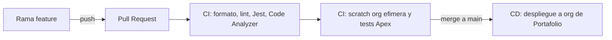

# Habitat Perú CRM

[](https://github.com/liusamfung/habitat-peru-crm/actions/workflows/ci.yml)
[](https://github.com/liusamfung/habitat-peru-crm/actions/workflows/cd.yml)

> **EN:** A Salesforce Service Cloud pilot for a fictional Peruvian holding with three
> business units (real estate, parking, hospitality) that share a single `Case` object
> through Record Types. It is a personal portfolio project: source-driven development with
> Salesforce DX, a private sharing model verified per role, and a CI/CD pipeline on GitHub
> Actions (static analysis, ephemeral scratch orgs, JWT deploy to a portfolio org).
> Documentation is written in Spanish; code, branches and commits are in English.

Piloto de **Salesforce Service Cloud** para "Corporación Habitat Perú", un holding
**ficticio** con tres unidades de negocio que comparten el objeto `Case` mediante Record
Types:

- **Habitat Inmobiliaria**: lotes, vivienda social, departamentos, posventa y garantías.
- **Habitat Parking**: playas de estacionamiento.
- **Habitat Hospitality**: hoteles.

Es un proyecto de práctica para portafolio de Salesforce Developer: unos 43 requerimientos
de negocio, la mayoría declarativos, y un subconjunto en Apex, LWC e integraciones.

## Estado

| Área                                                                             | Estado |
| -------------------------------------------------------------------------------- | ------ |
| Pipeline CI/CD, análisis estático y hooks de Git                                 | ✅     |
| **REQ-CASE-01**: Record Types por unidad, `Status`/`Type`/`Reason`, traducciones | ✅     |
| **REQ-SEC-01**: OWD privado de `Case`, jerarquía de roles, sharing rules         | ✅     |
| Resto de requerimientos (colas, SLA, Apex, LWC, integraciones…)                  | ⬜     |

El tablero completo, con el estado de cada requerimiento, está en
[docs/req/README.md](docs/req/README.md).

> Hasta ahora el repositorio contiene metadata declarativa e infraestructura. La única
> clase Apex (`CicdPipelineCheck`) es un smoke test del pipeline; el primer Apex real
> llega con REQ-CASE-05.

## Qué hay construido

### Gestión de casos (REQ-CASE-01)

Un único objeto `Case` con tres Record Types (`Real_Estate`, `Parking`, `Hospitality`),
un Business Process compartido y un solo layout. Los valores de `Status`, `Type` y `Reason`
son en inglés (el código compara el API name) y se muestran en español con Translation
Workbench. Detalle y decisiones en [docs/req/01-gestion-casos.md](docs/req/01-gestion-casos.md).

### Modelo de visibilidad (REQ-SEC-01)

El OWD de `Case` es **privado**. La visibilidad por unidad se logra con la **forma de la
jerarquía de roles**, no con una casilla (en `Case` "Grant Access Using Hierarchies" no se
puede desmarcar):

```
Holding
├── Real_Estate_Manager   └── Real_Estate_Agent
├── Parking_Manager       └── Parking_Agent
└── Hospitality_Manager   └── Hospitality_Agent
```

| Rol     | Casos propios     | Casos de pares de su unidad | Otras unidades |
| ------- | ----------------- | --------------------------- | -------------- |
| Agente  | Lectura y edición | Solo lectura                | No             |
| Gerente | Lectura y edición | Todos los de su unidad      | No             |
| Holding | Todos             | Todos                       | Todos          |

El "solo lectura entre pares" lo da una **sharing rule por criterio por unidad**, y cada
unidad tiene su permission set que solo habilita los Record Types propios. El modelo se
verificó con un usuario no administrador (el administrador ve todo) cambiando su rol.
Diseño completo en [docs/req/10-seguridad.md](docs/req/10-seguridad.md).

## Ingeniería

### Flujo de trabajo



- **CI** en cada Pull Request, en dos jobs encadenados. El primero no usa ninguna org
  (Prettier, ESLint, Jest y Salesforce Code Analyzer); el segundo crea una scratch org,
  despliega, asigna el permission set, corre los tests Apex y la borra siempre.
- **CD** en cada push a `main`: login JWT a la org de Portafolio, despliegue y tests.
- Un **ruleset de GitHub** (`protect-main`) exige Pull Request y los dos checks en verde.
- **Hooks de Git** (Husky): Prettier sobre lo staged al commitear y Code Analyzer al
  hacer push.
- Tres tipos de org: Dev Hub (solo presta scratch orgs), scratch orgs (una por feature) y
  Portafolio (acumula lo mergeado).

Decisiones y problemas reales documentados en [docs/devops/](docs/devops/): dos
workarounds de bugs del Salesforce CLI, por qué el CD no asigna permission sets y cómo
evitar que el _source tracking_ borre metadata de la org.

### Convenciones

| Ámbito                                   | Idioma                                                    |
| ---------------------------------------- | --------------------------------------------------------- |
| Ramas, commits, Pull Requests y código   | Inglés                                                    |
| API names de objetos y campos custom     | Inglés                                                    |
| Labels de objetos, campos y Record Types | Español                                                   |
| Valores de picklist                      | Inglés, con traducción al español (Translation Workbench) |
| Documentación (`docs/`, este README)     | Español                                                   |

Las ramas siguen `tipo/kebab` (`feature/req-case-05`) y los commits de un requerimiento
llevan su ID: `REQ-CASE-05: add satisfaction survey on case close`.

## Cómo ejecutarlo

Necesitas Node (versión en [.node-version](.node-version)), el
[Salesforce CLI](https://developer.salesforce.com/tools/salesforcecli) y un **Dev Hub**
autenticado.

```bash
npm ci
sf plugins install code-analyzer
```

```bash
sf org create scratch -f config/project-scratch-def.json -a habitat-scratch -d -y 7
sf project deploy start -o habitat-scratch -d force-app
sf org assign permset -n Case_All_Record_Types -o habitat-scratch
sf apex run test -o habitat-scratch -l RunLocalTests -r human
```

La asignación de un permission set es un dato, no metadata, y por eso no viaja en el
despliegue: hay que repetirla en cada scratch org.

Calidad de código en local:

```bash
npm run prettier:verify
npm run lint
npm run test:unit
npm run scan
```

## Estructura del repositorio

```
force-app/main/default/   metadata Salesforce (objetos, roles, sharing rules, permission sets, Apex…)
config/                   definición de la scratch org
docs/                     documentación en español
  req/                    los 43 requerimientos, uno por área funcional
  devops/                 flujo Git, orgs, CI/CD, autenticación JWT, calidad de código
.github/workflows/        ci.yml y cd.yml
scripts/                  utilidades
```

## Cómo se trabaja este proyecto

El objetivo es **aprender construyendo**. El código de negocio (Apex, LWC, pruebas) lo
escribe el autor; la IA se usa como tutor para explicar conceptos, revisar y depurar. La
infraestructura (CI/CD, scripts) y la documentación sí se construyeron con su ayuda. Las
reglas de colaboración están en [CLAUDE.md](CLAUDE.md).

## Documentación

| Archivo                                            | Contenido                                           |
| -------------------------------------------------- | --------------------------------------------------- |
| [docs/README.md](docs/README.md)                   | Índice maestro                                      |
| [docs/00-contexto.md](docs/00-contexto.md)         | Contexto, alcance y stakeholders                    |
| [docs/01-convenciones.md](docs/01-convenciones.md) | Tipos de implementación y requisitos no funcionales |
| [docs/req/](docs/req/)                             | Requerimientos funcionales y su tablero             |
| [docs/devops/](docs/devops/)                       | Git, orgs, CI/CD y calidad de código                |
